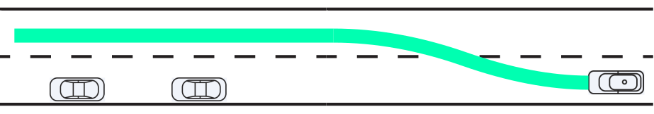
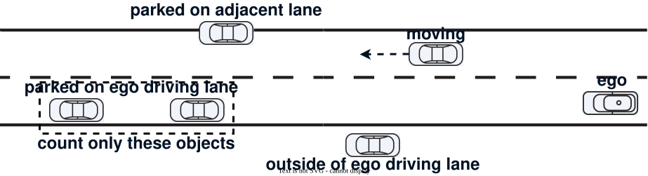
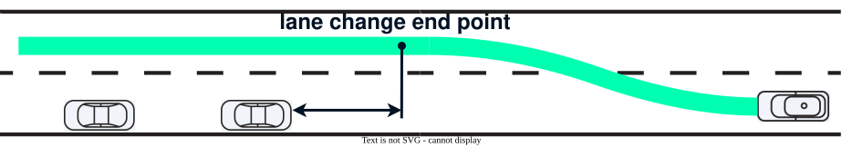

# Avoidance by lane change design

This is a sub-module to avoid obstacles by lane change maneuver.

## Purpose / Role

This module is designed as one of the obstacle avoidance features and generates a lane change path if the following conditions are satisfied.

- Exist lane changeable lanelet.
- Exist avoidance target objects on ego driving lane.



## Inner-workings / Algorithms

Basically, this module is implemented by reusing the avoidance target filtering logic of the existing [Static Object Avoidance Module](../autoware_behavior_path_static_obstacle_avoidance_module/README.md) and the path generation logic of the [Normal Lane Change Module](../autoware_behavior_path_lane_change_module/README.md). On the other hand, the conditions under which the module is activated differ from those of a normal avoidance module.

Check that the following conditions are satisfied after the filtering process for the avoidance target.

### Number of the avoidance target objects

This module is launched when the number of avoidance target objects on **EGO DRIVING LANE** is greater than `execute_object_num`. If there are no avoidance targets in the ego driving lane or their number is less than the parameter, the obstacle is avoided by normal avoidance behavior (if the normal avoidance module is registered).



### Lane change end point condition

Unlike the normal avoidance module, which specifies the shift line end point, this module does not specify its end point when generating a lane change path. On the other hand, setting `execute_only_when_lane_change_finish_before_object` to `true` will activate this module only if the lane change can be completed before the avoidance target object.

Although setting the parameter to `false` would increase the scene of avoidance by lane change, it is assumed that sufficient lateral margin may not be ensured in some cases because the vehicle passes by the side of obstacles during the lane change.



## Parameters

| Name                                               | Unit | Type   | Description                                                                                                                              | Default value |
| :------------------------------------------------- | ---- | ------ | ---------------------------------------------------------------------------------------------------------------------------------------- | ------------- |
| execute_object_num                                 | [-]  | int    | Number of avoidance target objects on ego driving lane is greater than this value, this module will be launched.                         | 1             |
| execute_object_longitudinal_margin                 | [m]  | double | [maybe unused] Only when distance between the ego and avoidance target object is longer than this value, this module will be launched.   | 0.0           |
| execute_only_when_lane_change_finish_before_object | [-]  | bool   | If this flag set `true`, this module will be launched only when the lane change end point is **NOT** behind the avoidance target object. | true          |

## Closed-site opposite-lane borrowing / 封闭园区对向借道

`avoidance_by_lane_change.enable_opposite_lane_borrowing` defaults to `false`.
When enabled, a safe same-direction lane change still has priority. If no safe
same-direction candidate exists, an independent planner can borrow an immediately
adjacent opposite-direction **road** lane and return to the original route lane.
It does not depend on the Simple LC module and does not change NormalLaneChange's
oncoming-object filtering or routing behavior.

### Execution contract

- Only shared painted/virtual boundaries (`line_thin`, `line_thick`, `virtual`)
  are accepted. Physical separators and unknown boundary encodings are rejected.
  Closed-site operation may cross painted solid lines; this is not a public-road
  traffic-rule implementation. Road shoulders are not candidates.
- Inverted lane geometry is used for planning; raw map direction and lane IDs
  remain available for object association. Inverted lane sections must connect;
  the complete tractor/trailer swept footprint must fit inside the lane union.
  Missing opposite sections, crosswalks and intersections reject the maneuver.
- RTC approves the outgoing and returning maneuver together. Target, route,
  trailer configuration or branch changes invalidate pending approval. Force
  activation cannot bypass the planner's safety gate. After commitment, safety
  return and braking do not require another approval.
- The outgoing path, reference lane and avoidance target are retained during
  execution. Target disappearance does not discard the maneuver or remove the
  held obstacle from collision checking. A recovery return is accepted only if
  it joins the measured offset and heading and passes the full safety check.
  Otherwise, braking preserves the committed geometry.
- Full perception is checked without class, heading or current-lane filters.
  All predicted modes plus a constant-twist fallback are checked, including
  objects currently outside the borrowing lane. Prediction time includes
  perception age, acceleration bounds and the return time gap. Stops and slow
  motion are not replaced with an artificial minimum speed. A return exceeding
  the prediction horizon is rejected rather than truncated.
- New upstream speed limits are respected while retaining committed geometry.
  Stale perception/odometry, invalid configuration, geometry failure or exhausted
  planning budget blocks departure or triggers braking while committed.

### Parameters and trailer state

Both package and launch parameter files contain the same new configuration.
Edit the **launch-loaded** `avoidance_by_lane_change/avoidance_by_lane_change.param.yaml`
when using `autoware_launch`, and rebuild/install the launch package as required
by the workspace's install layout. New parameters are startup parameters.

The `opposite_lane` defaults are: maximum speed **2 m/s**, prediction horizon
**30 s**, temporal resolution **0.5 s**, time gap **3 s**, longitudinal/lateral
object margins **2/0.5 m**, clearance hold **1 s**, return buffer **5 m**, data
age limit **0.5 s**, planning budget **50 ms**, preparation **3 m**, minimum
shift length **5 m**, and road-boundary margin **0.1 m**. Shift geometry also
uses the existing lane-change lateral jerk and acceleration limits. The return
buffer starts after the estimated rear of the complete train clears the object.
Longer/slower maneuvers can be rejected by the 30-second horizon; such a rejection
is not permission to shorten the prediction or increase planning speed.

The latched `/vehicle/status/trailer_configuration` message is required even for
an unhitched tractor: an **empty array explicitly means no trailers**. Missing
messages and unknown trailer types block borrowing. Type geometry and hitch
conventions match the common articulated-vehicle utility and the Simple LC
configuration (`default`, `wide`, `articulation`).

The configuration message contains trailer types, not measured hitch angles.
Trailer poses are therefore **kinematic estimates from measured tractor history**.
With trailers attached, the planner requires at least twice the estimated train
length of observed forward motion before departure. Ground-truth trailer pose
or articulation validation still requires a simulator/vehicle measurement source;
the footprint estimates do not establish physical trailer-ground-truth accuracy.

### Simulation and acceptance

Isolate the avoidance module in the planning simulator using:

```text
launch_avoidance_by_lane_change_module:=true
launch_static_obstacle_avoidance:=false
launch_simple_avoidance:=false
launch_simple_lc_avoidance:=false
```

Enable borrowing in the loaded YAML, use a map with shared-boundary opposite
road lanes, and approve the RTC request using the deployment's existing RTC
controls. The test driver publishes trailer configuration but does not bypass RTC.
Run from the workspace root, after launching the simulator:

```bash
python3 src/byd/obstacle_avoidance_limit_test/scripts/simple_avoidance_distance_test.py \
  --mode avoidance_by_lane_change --case-name opposite_left \
  --lock-mode steady_speed_lock --speed 2.0 --distance 25.0 \
  --intrusion 0.5 --shoulder right \
  --sample-sec 60 --record-bag --output-dir /tmp/opposite_left
```

Map-specific ego/goal coordinates may be passed with the existing driver options.
Use `--shoulder left` for the mirrored case, `--scenario adjacent_lane_occupied`
for a blocked corridor, target-loss scenarios for continuity, and
`--trailer-types default` (or multiple comma-separated types) for articulated
vehicles. Trailer scenarios need a forward-motion warmup before inserting the
obstacle. Use a fresh simulator for each acceptance case.

The driver adds `borrowing_*` CSV fields for minimum estimated body clearance,
estimated actual footprint violations, all-body return, COMPLETE event and maximum
planning time. Live `/rosout` is required; missing diagnostics are not treated as
successful evidence. `actual_*` in planner diagnostics means measured tractor
odometry with predicted trailer poses, not independently measured trailer poses.

ROS regression commands:

```bash
colcon build --packages-up-to autoware_behavior_path_avoidance_by_lane_change_module \
  --cmake-args -DCMAKE_BUILD_TYPE=RelWithDebInfo -DBUILD_TESTING=ON
colcon test --packages-select \
  autoware_behavior_path_avoidance_by_lane_change_module \
  autoware_behavior_path_lane_change_module \
  autoware_behavior_path_simple_lane_change_avoidance_module
colcon test-result --verbose
```

Build the other two packages with `BUILD_TESTING=ON` first if they are not already
built. ROS tests cover both borrowing sides, corridor gaps, prohibited crossing,
obstacles outside the current lane, invalid prediction, insufficient horizon,
held targets, trailer envelopes/articulation, same-direction priority, opt-in
behavior and geometry-preserving braking.

Host-only checks (no ROS required):

```bash
g++ -std=c++17 -Wall -Wextra -Werror -pedantic \
  -Isrc/universe/autoware_universe/planning/behavior_path_planner/autoware_behavior_path_avoidance_by_lane_change_module/src \
  src/universe/autoware_universe/planning/behavior_path_planner/autoware_behavior_path_avoidance_by_lane_change_module/test/test_borrowing_math.cpp \
  -o /tmp/test_borrowing_math
/tmp/test_borrowing_math
python3 -m unittest discover -s src/byd/obstacle_avoidance_limit_test/test \
  -p test_opposite_borrowing_metrics.py -v
```

Before vehicle rollout, run the ROS suite, collision/return scenarios with oncoming
traffic introduced before and after departure, route/trailer changes during a
maneuver, and map-boundary/clearance validation against simulator ground truth.
The host-only checks do not substitute for ROS compilation or simulation.
